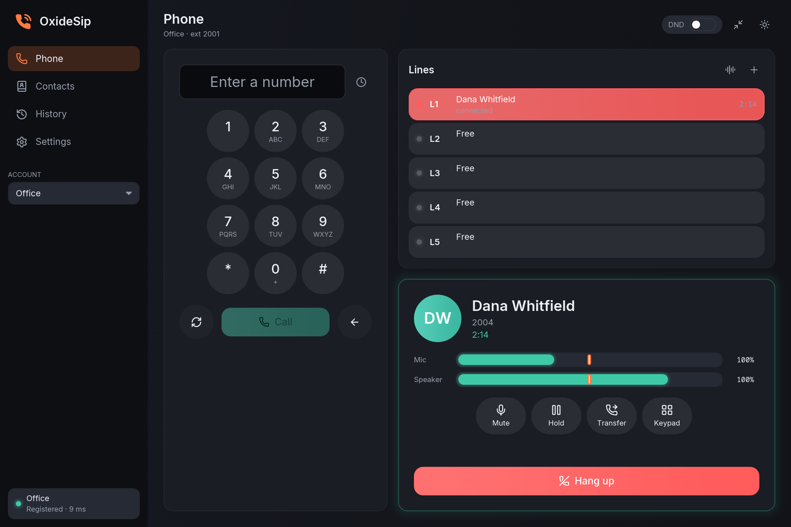
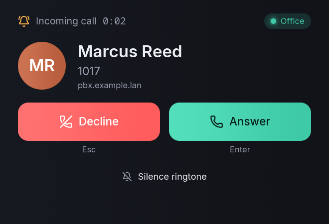
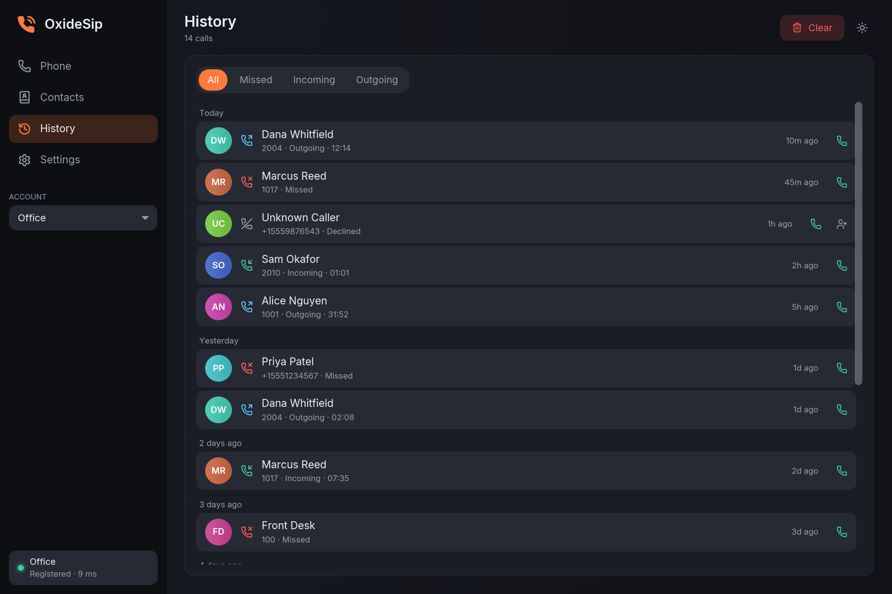
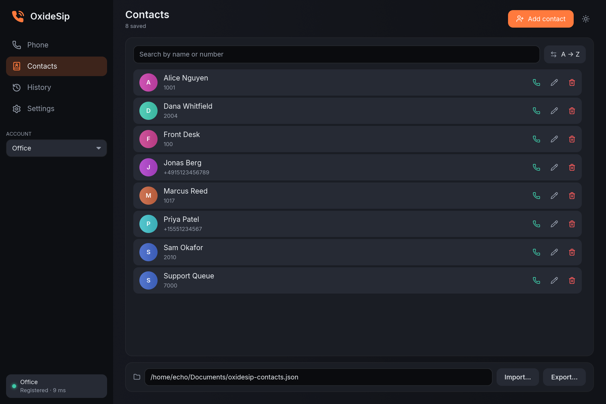
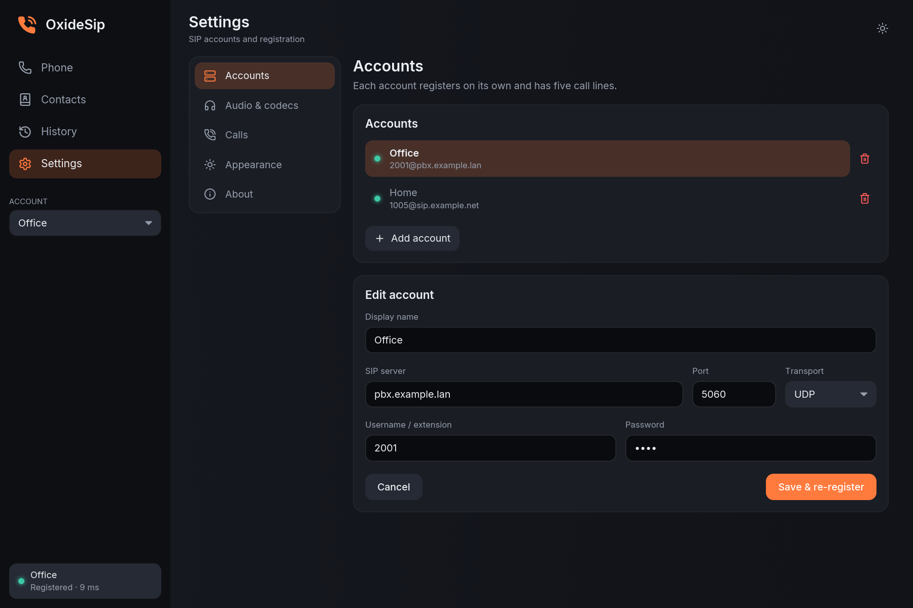

<p align="center">
  
</p>

<h1 align="center">OxideSip</h1>

<p align="center">
  A native Linux SIP softphone with PipeWire audio. Multiple accounts, five lines each,
  hold / transfer / join, a real incoming-call window, and call audio you can route
  into Discord or any other app.
</p>

<p align="center">
  <a href="https://github.com/ZeroDay-Labz/OxideSip/releases/latest"></a>
  <a href="https://github.com/ZeroDay-Labz/OxideSip/actions/workflows/ci.yml"></a>
  <a href="https://github.com/ZeroDay-Labz/OxideSip/releases"></a>
  <a href="LICENSE"></a>
</p>

<p align="center">
  
</p>

## What is it?

OxideSip registers your SIP extensions with a PBX (FreePBX, Asterisk, 3CX, anything standard)
and behaves like a desk phone on your desktop. It is written in Rust, draws its own interface
with [iced](https://github.com/iced-rs/iced), and talks to PipeWire directly — no PulseAudio
layer, no browser engine.

- **Multiple accounts, five lines each.** Every account registers on its own. Hold, resume,
  blind transfer, start a second call, and join two lines into a local three-way call.
- **Incoming calls you cannot miss.** A small always-on-top window with big Answer / Decline
  buttons (Enter / Esc), plus a desktop notification with the same two actions. Simultaneous
  calls stack in the same window.
- **Caller ID done right.** The caller's name and number come from the SIP headers and are
  matched against your contacts by number, so "+1 555 123 4567" finds the contact you saved
  as "5551234567".
- **Route the call anywhere.** Send the other party's voice into another app's live input
  (Discord's voice engine, OBS, a virtual sink) or mix another app's audio into what the far
  end hears — per call, with one button.
- **Standards you expect.** RFC 4733 DTMF with SIP INFO fallback, an ordered codec priority
  list (G.711 µ-law / A-law), optional SDES-SRTP, UDP / TCP / TLS transports.
- **The rest of a phone.** Contacts with JSON import/export, call history with filters and
  missed-call badge, Do Not Disturb, auto-answer, a deny list, WAV call recording, a compact
  floating call bar, keyboard shortcuts, dark and light themes that follow the desktop.

<p align="center">
  
  
</p>
<p align="center">
  
  
</p>

## Install

| | |
|---|---|
| **Fedora, openSUSE, RHEL family** | Download the `.rpm` from the [latest release](https://github.com/ZeroDay-Labz/OxideSip/releases/latest), then `sudo dnf install ./oxidesip-*.rpm` |
| **Debian, Ubuntu, Mint, Pop!_OS** | Download the `.deb`, then `sudo apt install ./oxidesip_*.deb` |
| **Any Linux** | Download `oxidesip-x86_64.flatpak`, then `flatpak install --user ./oxidesip-x86_64.flatpak`; or unpack `oxidesip-linux-x86_64.tar.gz` and run `./oxidesip` |
| **From source** | See [Building](#building) |

The packages install the app, its launcher and icons, and declare their shared-library
dependencies (PipeWire and friends) from the binary itself. A `SHA256SUMS` file sits next to
every release asset.

### Requirements

| | |
|---|---|
| Sound server | **PipeWire** 0.3.44 or newer as the session's audio server (the Fedora / KDE / GNOME default) |
| Desktop | Wayland or X11. Any GPU; virtual machines fall back to software rendering |
| Account | A SIP extension on a PBX you can reach — on the LAN or over a VPN (no STUN / ICE yet) |

## Using it

1. Start **OxideSip** from your launcher (or run `oxidesip`). The first run opens
   **Settings ▸ Accounts** — enter the server, extension and password and press
   **Add account**. The pill at the bottom of the sidebar turns green when you are registered.
2. **Phone** page: type a number or use the keypad, press **Call** or Enter. Pick a contact or a
   history entry to call it directly. Each of the five lines shows who is on it and for how long.
3. When a call comes in, the incoming window appears on top of everything. **Enter** or **A**
   answers, **Esc** or **D** declines, **S** silences the ringtone. The desktop notification has
   the same Answer / Decline buttons.
4. During a call: mute, hold, transfer (type a number or SIP URI), open the in-call keypad for
   DTMF, start another call on a free line with **+**, and **Join** two active lines. The
   shrink button in the top bar (or **Ctrl+Shift+C**) turns the window into a small floating
   call bar.

| Page | What is there |
|---|---|
| **Phone** | Dial card, the five lines with live state, the selected line's call card |
| **Contacts** | Search, sort, call / edit / delete, JSON import and export (also reads MicroSIP-style exports) |
| **History** | All / Missed / Incoming / Outgoing, grouped by day, call back or add to contacts |
| **Settings** | Accounts · Audio & codecs · Calls (DND, auto-answer, notifications, deny list, recording, secondary audio) · Appearance · About |

### Routing a call into Discord (or any other app)

Open **Settings ▸ Calls ▸ Secondary audio** while you are in the voice channel, press the
refresh button, and pick the app's entry (prefixed `App:`). *Also send the other party's voice
to* links the far end straight into that app's live input stream, the same way `qpwgraph` or
`helvum` would patch one client into another. *Mix into what the other party hears, from*
does the reverse, and is switched on per call with the wave button in the Lines card. If the
app is not listed it is not currently listening for audio; a virtual sink of your own works too.

### Keyboard shortcuts

| Shortcut | Action |
|---|---|
| `Enter` | Call the typed number, or answer a ringing call |
| `Esc` | Decline a ringing call · press twice to hang up |
| `0–9` `*` `#` | Dial, or send DTMF during a call |
| `Backspace` | Delete the last digit |
| `Ctrl+1` … `Ctrl+4` | Phone, Contacts, History, Settings |
| `Ctrl+K` | Focus the number field (or the contact search) |
| `Ctrl+M` / `Ctrl+H` / `Ctrl+T` | Mute / hold / transfer the current call |
| `Ctrl+Shift+C` | Compact call bar |
| `Ctrl+B` | Collapse the sidebar |
| `Ctrl+,` | Settings |
| `Ctrl+Q` | Quit (asks first if a call is up) |
| `A` / `D` / `S` | Answer / Decline / Silence, in the incoming-call window |

### From the terminal

```sh
oxidesip                        # the app
oxidesip sip:1001@pbx.lan       # start with a number in the dial field (also tel: URIs)
oxidesip --demo                 # the real UI on a scripted backend: no SIP, no audio, nothing saved
oxidesip --screenshot docs/shots --page all   # render the documentation screenshots and exit
oxidesip --help
```

The `.desktop` entry registers OxideSip as a handler for `sip:` and `tel:` links, so a phone
number clicked in a browser can open here.

## Troubleshooting

- **The sidebar pill stays "Connecting…".** The server or port is wrong, or the PBX is not
  reachable from this network. **"Stopped"** means the PBX refused the credentials (403, or
  repeated 401/407); fix the account and press **Save & re-register**.
- **TLS does not connect.** A CA certificate path is required for TLS; set it in the account
  file (see [Where your stuff is kept](#where-your-stuff-is-kept)). Client certificates are
  optional.
- **No audio, or the wrong device.** Pick the microphone and speaker under
  **Settings ▸ Audio & codecs**. Device changes apply to the next call; the ringtone and dial
  tones follow after a restart. `pw-top` shows whether the `OxideSip` streams are running.
- **No taskbar icon on Wayland.** The icon comes from the installed `.desktop` entry matched by
  app id (`io.github.zerodaylabz.OxideSip`). If you run a tarball binary, install
  `packaging/io.github.zerodaylabz.OxideSip.desktop` and the SVG icon into
  `~/.local/share/applications/` and `~/.local/share/icons/hicolor/scalable/apps/`.
- **The incoming window does not come to the front.** KDE and GNOME may refuse to raise a new
  window over a full-screen app; the task-bar entry pulses instead and the desktop notification
  carries Answer / Decline. Make sure *Desktop notifications* is on under **Settings ▸ Calls**.
- **Blank or very slow window in a VM.** Run with `ICED_BACKEND=tiny-skia oxidesip` (software
  rendering).
- **One-way audio or no audio behind NAT.** OxideSip has no STUN / ICE yet; use it on the LAN
  or over a VPN to the PBX.

## Where your stuff is kept

| | |
|---|---|
| Accounts | `~/.config/oxidesip/accounts.toml` |
| Call-handling settings, theme | `~/.config/oxidesip/settings.toml` |
| Audio devices | `~/.config/oxidesip/audio_devices.toml` |
| Contacts, call history | `~/.config/oxidesip/contacts.toml`, `call_history.toml` |
| Window size, page, filters | `~/.config/oxidesip/ui_state.toml` |
| Recordings | The folder you pick under **Settings ▸ Calls ▸ Recording** |

Inside the Flatpak the same files live under `~/.var/app/io.github.zerodaylabz.OxideSip/config/oxidesip/`.
**Settings ▸ About ▸ Open config folder** takes you there. Nothing is written in `--demo` mode.

To seed an account without the UI, copy
[`softphone-core/config.example.toml`](softphone-core/config.example.toml) into
`accounts.toml` as an `[[accounts]]` entry, or set `OXIDESIP_*` environment variables
(`OXIDESIP_SIP_SERVER_HOST`, `OXIDESIP_SIP_SERVER_PORT`, `OXIDESIP_TRANSPORT`,
`OXIDESIP_USERNAME`, `OXIDESIP_PASSWORD`, `OXIDESIP_REGISTER_EXPIRES`, `OXIDESIP_LOCAL_PORT`,
`OXIDESIP_SRTP`, `OXIDESIP_CA_CERT_PATH`, `OXIDESIP_CLIENT_CERT_PATH`, `OXIDESIP_CLIENT_KEY_PATH`,
`OXIDESIP_PREFERRED_CODECS`) for the first run; they are migrated into `accounts.toml`.

## Building

```sh
# Fedora
sudo dnf install pipewire-devel clang-devel pkgconf-pkg-config libxkbcommon-devel wayland-devel
# Debian / Ubuntu
sudo apt install libpipewire-0.3-dev libclang-dev pkg-config libxkbcommon-dev libwayland-dev
# Arch
sudo pacman -S pipewire clang pkgconf libxkbcommon wayland

git clone https://github.com/ZeroDay-Labz/OxideSip && cd OxideSip
cargo run --release -p softphone-ui
```

Rust 1.88 or newer. `cargo test --workspace` runs the SIP, SDP and codec tests;
`cargo clippy --workspace --all-targets -- -D warnings` and `cargo fmt --check` must stay
clean (CI enforces both). `scripts/render-icons.sh` regenerates the icon PNGs from the SVG,
`scripts/screenshots.sh` regenerates `docs/screenshots/` with the app's own `--screenshot` mode.
See [CONTRIBUTING.md](CONTRIBUTING.md).

| Crate | Purpose |
|---|---|
| `softphone-core` | SIP signalling via [`rsipstack`](https://crates.io/crates/rsipstack): registration, dialogs, SDP negotiation, structured caller identity. No UI or audio code. |
| `softphone-media` | PipeWire capture and playback, RTP send/receive with RFC 4733 events, tones, WAV recording, G.711 codecs, secondary-stream routing. |
| `softphone-ui` | The iced desktop app: theme, pages, incoming-call window, notifications, demo and screenshot modes, packaging metadata. |

Tagged pushes (`v*`) run [`release.yml`](.github/workflows/release.yml), which builds the
tarball, RPM, deb and Flatpak bundle and attaches them to the GitHub release.

## Known limitations

- **No STUN / ICE.** Works on a LAN or over a VPN to the PBX; NAT traversal is not handled.
- **No echo cancellation.** Use a headset, or rely on the PBX / the other side's AEC.
- **Blind transfer reports "requested", not "completed".** `rsipstack` exposes whether the REFER
  was accepted but not the follow-up NOTIFY that would say whether the target answered.
- **Call forwarding is not implemented** (the stack cannot send a SIP 3xx yet); the old toggle
  has been removed from Settings.
- **Keyboard focus** reaches text fields and the shortcuts above; buttons and toggles are not
  Tab-focusable in this version of iced.

## Credits

Built with [iced](https://github.com/iced-rs/iced), [rsipstack](https://github.com/restsend/rsipstack)
and [PipeWire](https://pipewire.org). UI font: [Inter](https://rsms.me/inter/) (SIL OFL 1.1).
Icons: [Lucide](https://lucide.dev) (ISC).

## License

MIT. See [LICENSE](LICENSE).
